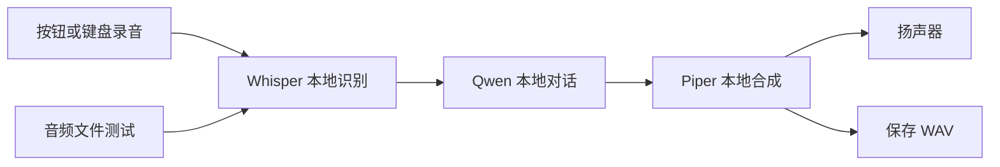

# Pi Companion · 小派语音人偶

把树莓派变成可以说话的桌面伙伴：按住按钮说话 → 本地识别 → 本地模型回答 → 扬声器播放。外壳可以换成玩偶或桌面摆件。也能先在电脑上用键盘和音频文件验证。

**Alpha：电脑上的模型链路验证与树莓派实机验收分开记录，见 [VALIDATION.md](VALIDATION.md)。目前没有树莓派实机通过记录。** 本项目针对 Raspberry Pi 4/5 的 Linux 64 位系统，不是 Pico 微控制器。没有移动底盘、摄像头或持续唤醒词监听。

## 组成



- Whisper.cpp（通过 pywhispercpp 1.4.0）`base` 多语言模型：语音转文字。
- llama.cpp + Qwen3-0.6B Q8：本地对话；也支持填写 HTTPS OpenAI-compatible Chat Completions 地址。
- Piper：文字转语音。
- Python：录音、按钮/LED、对话状态和临时文件管理。

默认模型文件约 850 MB，安装及编译需要额外空间。建议先使用已有电脑验证；树莓派性能、温度、音频设备兼容性需要实测，不承诺即时回答。小模型的事实准确性和中文表达有限；已观察到长句识别错误及随后编造信息的情况，具体失败例子也记录在验证文档中。

## 安装

目标系统：树莓派 OS 64 位；开发验证环境见验证记录。准备 Python 环境管理工具 [uv](https://docs.astral.sh/uv/getting-started/installation/)、Git、curl 和 C/C++ 编译器。

树莓派系统依赖（阅读后在自己的树莓派终端执行）：

```bash
sudo apt update
sudo apt install -y git curl build-essential libportaudio2 libsndfile1 pkg-config
```

克隆并构建项目内的环境，不修改系统 Python：

```bash
git clone https://github.com/LYnini752/pi-companion.git
cd pi-companion
bash scripts/setup.sh
.venv/bin/python scripts/download_models.py
```

脚本会从经 SHA-256 验证的上游 llama-cpp-python 0.3.16 源码包提取固定 llama.cpp 源码，安装预编译 pywhispercpp（支持的平台），创建 `.venv` 并复制 `config.example.json` 为 `config.local.json`；已有配置不会覆盖。默认两线程编译，可通过 `BUILD_JOBS=4 bash scripts/setup.sh` 调整。模型下载使用固定版本与 SHA-256 校验，支持中断续传；校验失败会停止。

**音色需单独选择。** 默认示例使用的中文 huayan 音色，其模型卡将数据集许可列为 Unknown，不应直接当作可随商业套盒分发的音色。本仓库不附带任何模型权重。你可以在 `config.local.json` 设置自己获准使用的 Piper `.onnx` 和同名 `.onnx.json` 文件；如了解这一限制并仅做本地测试，可以下载示例音色：

```bash
.venv/bin/python scripts/download_models.py --include-demo-voice
```

详细组件与音色来源见 [THIRD_PARTY.md](THIRD_PARTY.md)。

## 先在电脑上验证

终端一运行模型服务器，仅监听本机：

```bash
bash scripts/serve_llm.sh
```

终端二：

```bash
.venv/bin/python companion.py --doctor
.venv/bin/python companion.py --prompt '你好，请用一句话介绍自己。'
.venv/bin/python scripts/demo.py
.venv/bin/python companion.py --audio /absolute/path/question.wav --output .local/reply.wav
```

`scripts/demo.py` 会自己合成一句测试提问，再识别、回答并保存 `.local/demo/reply.wav` 与 `run.json`，不需要准备音频，也不录音或播放。

文件模式接受 0.2–30 秒 WAV/FLAC/OGG，最多 30 MB，自动转换为 16 kHz 单声道；它不会打开麦克风或播放声音。输出包括识别文字、回复和各阶段耗时。`--doctor` 只检查文件，缺组件时返回非零退出码，不代表硬件已通过。

麦克风交互：

```bash
.venv/bin/python companion.py --devices
.venv/bin/python companion.py
```

按 Enter 开始，再按 Enter 结束，最多 30 秒自动停止。设备按自己的默认采样率录音，再转换供识别使用；扬声器也按输出设备采样率转换。可以在配置中设置 `input_device` / `output_device` 为设备索引或名称。设备拔插后索引可能改变。`/quit` 退出，`/reset` 清空对话；`--text` 进入纯文字交互模式。

## 接按钮与 LED

见 [HARDWARE.md](HARDWARE.md)。接线完成后才启用 GPIO：

```bash
uv pip install --python .venv/bin/python gpiozero==2.0.1 lgpio==0.2.2.0
.venv/bin/python companion.py --gpio --button-pin 17 --led-pin 27
```

按住按钮录音，松开后处理。LED 常亮表示录音，闪烁表示处理，结束后关闭。每次回答结束前不再录音，因此扬声器不会触发下一次对话。按住超过 30 秒会停止录音，必须松开才能再次开始。

`systemd/` 提供两个模板；**先手动验证全部链路和 GPIO，再安装服务**。模板假设目录为 `/home/<用户名>/pi-companion`，其他位置需要改 `WorkingDirectory` / `ExecStart`。用户需有音频和 GPIO 设备访问权限；不要为方便而以 root 运行整个聊天程序。

```bash
sudo cp systemd/pi-companion*.service /etc/systemd/system/
sudo systemctl daemon-reload
sudo systemctl enable --now "pi-companion-llm@$USER" "pi-companion@$USER"
journalctl -u "pi-companion@$USER" -f
# 停用
sudo systemctl disable --now "pi-companion@$USER" "pi-companion-llm@$USER"
```

GPIO 服务只输出状态，不输出聊天正文。服务和真实 GPIO 尚需实机验证；模型启动前按按钮可能失败，等待模型就绪后再试。

## 配置、数据与边界

相对模型路径以配置文件所在文件夹为基准，不依赖启动目录。最多保留最近六轮对话于内存；为适应小模型，发送上下文按 3000 UTF-8 字节保守限制，超出时丢弃最早的完整轮次；正常退出后不保存。音频和识别结果在处理期间写入系统临时目录，正常结束/异常处理会删除；强制断电可能留下临时文件。显式指定 `--output` 的音频会保留。

默认推理都在本地完成；安装时需要联网下载软件和模型。若换成远程 API，识别后的文字、人物设定和最近对话会发送到该服务，音频仍由本地引擎处理。使用 `api_key_env` 指定环境变量名，不要把真实密钥写入配置或提交到仓库。示例：

```json
{"name":"Remote","model":"YOUR_MODEL","base_url":"https://YOUR_HOST/v1","api_key_env":"PI_CHAT_API_KEY"}
```

远程服务通常不接受 llama.cpp 的 `chat_template_kwargs`，替换整个 `model` 配置时删除这一选项。程序拒绝 HTTP 公网地址和 HTTP 重定向。没有云同步、自动购买或控制家电功能。

## 测试

```bash
uv pip install --python .venv/bin/python pytest gpiozero==2.0.1
.venv/bin/python -m pytest -q
```

核心自动测试不接触麦克风和 GPIO，不下载大模型；它们不能代替树莓派实机验证。GitHub Actions 运行同一核心测试，并在 Ubuntu x86_64 与 ARM64 构建引擎。ARM64 任务还下载固定测试模型并运行真实语音回路；这是云端 ARM 机器，仍不是树莓派实机。实际模型验证、已知问题见 [VALIDATION.md](VALIDATION.md)。

代码：GPL-3.0。模型及第三方组件遵循各自许可。欢迎提交真实硬件型号、系统版本、设备信息与脱敏日志。
